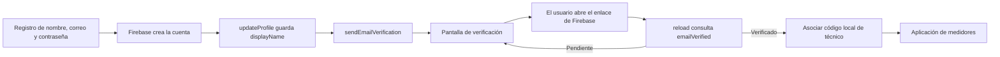
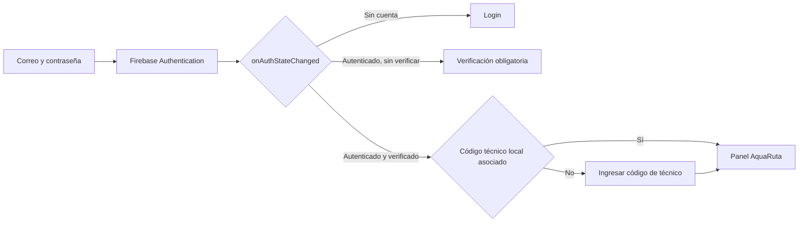

# Autenticación de AquaRuta

## Configuración de Firebase

1. Crea o selecciona un proyecto desde Firebase Console y agrega una aplicación web.
2. En **Authentication → Sign-in method**, habilita **Correo electrónico/contraseña**.
3. Copia `.env.example` como `.env.local` y completa los seis valores de Firebase. No uses credenciales de otro proyecto ni las subas al repositorio.
4. Reinicia Metro después de cambiar variables de entorno: `npx expo start --clear`.
5. Instala la app y crea una cuenta nueva. La app solo puede enviar correos cuando el proyecto Firebase tiene habilitado el proveedor indicado.

Las variables `EXPO_PUBLIC_*` se incorporan al bundle del cliente y no son secretos. Las claves de API de Firebase identifican el proyecto; nunca incluyas claves privadas de cuentas de servicio en la aplicación.

## Flujos

### Registro

### Inicio de sesión

## Persistencia y protección

En Android/iOS, `initializeAuth` usa `getReactNativePersistence(AsyncStorage)` para que Firebase restaure la cuenta al volver a abrir la app. En web se usa `getAuth`, que utiliza la persistencia disponible en el navegador. `onAuthStateChanged` es la fuente de verdad; no se guarda ninguna contraseña.

Expo Router protege los grupos de rutas:

- Público: login, registro y recuperación.
- Cuenta Firebase activa sin correo verificado: solo verificación.
- Cuenta verificada sin código de trabajo: asociación del código.
- Cuenta verificada con asociación local al UID actual: funciones de medidores, lecturas, perfil y borradores.

Un usuario no verificado nunca obtiene acceso a las rutas de medidores, aunque abra una URL protegida o use el botón atrás. La pantalla de verificación llama a `reload` cuando el usuario regresa a la app y ofrece comprobar manualmente o reenviar el mensaje.

## Cuenta y contraseñas

- Registro: nombre de al menos tres caracteres, correo válido, contraseña de ocho caracteres o más y confirmación exacta.
- Recuperación: Firebase envía el enlace. El mensaje de la app es neutral para no revelar si una dirección está registrada.
- Cambio de contraseña: el usuario escribe la clave actual y la nueva dos veces; se ejecutan `reauthenticateWithCredential` y `updatePassword`, en ese orden.
- Edición del perfil: `updateProfile` cambia `displayName`; el contexto incrementa su versión para refrescar el saludo sin cerrar sesión.
- Cierre de sesión: Firebase cierra la cuenta y SQLite elimina solamente la sesión de trabajo. Lecturas, fotos, caché y borradores permanecen en el dispositivo.

## Asociación con el técnico local

Firebase autentica una dirección de correo; no existe en el proyecto un servicio que vincule ese correo a un técnico de MockAPI. Para mantener los datos actuales, después de verificar el correo se solicita por separado un código local de técnico. El código selecciona el perfil de demostración, y SQLite registra el UID de Firebase en la fila de sesión. Al restaurar la app, la sesión local solo se acepta si el UID coincide y la cuenta sigue verificada.

Esta selección de código **no verifica la identidad laboral**. Los códigos de demostración son datos públicos de la app; la asociación solo evita mezclar accidentalmente sesiones locales de cuentas distintas. Una aplicación de producción debe reemplazarla por una asignación verificada desde un backend autorizado. Firebase no se vincula ni se iguala con MockAPI.

## Interfaz, Uniwind y animaciones

Metro usa Uniwind 1.x con Tailwind CSS 4 y `src/global.css`. Todas las pantallas, incluida la autenticación y el flujo de medidores, y los componentes compartidos usan clases `className` para sus estilos visuales; no quedan llamadas a `StyleSheet.create` en `src/`. Los estilos en línea se reservan para valores dinámicos o estilos del sistema, y las animaciones usan Reanimated 4.

Animaciones aplicadas:

1. Entrada FadeInDown/FadeInUp en login y formularios de cuenta/perfil.
2. Shake horizontal solo al fallar credenciales válidas del login.
3. Entrada escalonada de bienvenida, tarjeta, perfil y estadísticas del panel.
4. Respuesta elástica al pulsar botones de autenticación.
5. Fade de alertas de error y confirmación.
6. Cambio animado de los segmentos del medidor de seguridad de contraseña.

Se respeta la preferencia del sistema para reducir movimiento en las entradas y los botones. El indicador de contraseña es orientación visual, no una auditoría de seguridad.

## Guion breve para la defensa

- **Firebase Authentication:** evita crear un sistema propio para almacenar y verificar contraseñas.
- **Autenticación y autorización:** autenticar comprueba quién inició sesión; las rutas protegidas deciden qué pantallas puede abrir.
- **`onAuthStateChanged`:** notifica cuándo Firebase restaura, inicia o cierra la sesión.
- **AsyncStorage:** conserva la persistencia de Firebase en React Native entre aperturas; no almacena la contraseña de la app.
- **`updateProfile`:** actualiza el nombre visible (`displayName`) de la cuenta.
- **Reautenticación:** cambiar una contraseña requiere una prueba reciente de identidad para proteger una cuenta abandonada o comprometida.
- **`sendEmailVerification`:** envía un enlace y Firebase establece `emailVerified` después de que se utiliza.
- **Reanimated:** realiza transiciones y respuestas interactivas de forma fluida en el hilo de UI.
- **Uniwind:** permite compartir utilidades de estilo con `className` en lugar de mantener estilos repetidos.
- **Prueba I:** SQLite, el caché, las fotos, los borradores y la cola de sincronización permanecen locales; cerrar sesión no los borra.

## Pruebas que requieren configuración externa

Para validar registro, inicio, correo, recuperación, reautenticación y persistencia hay que configurar un proyecto Firebase real (o un emulador Firebase) y probar en Android/iOS. Sin credenciales, las pantallas de cuenta muestran que falta configuración y no pueden completar operaciones remotas.
